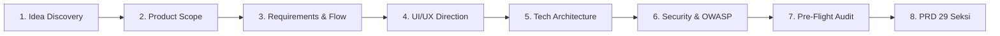

# Personal Product Assistant — AI Product Architect Telegram Bot

Personal Product Assistant adalah bot Telegram AI kelas dunia yang bertindak sebagai **AI Product Architect**. Bot ini membimbing Anda mentransformasikan ide mentah website maupun aplikasi menjadi dokumen **Product Requirements Document (PRD) 29 Seksi Berstandar Industri** yang komprehensif, memiliki arah desain UI/UX khas (*anti-slop*), skema basis data PostgreSQL DDL lengkap, spesifikasi REST API, mitigasi keamanan berbasis **OWASP Top 10**, serta siap dieksekusi oleh developer manusia maupun AI Coding Agent (Cursor, Claude Code, Devin, dll.).

---

## 🏛️ Arsitektur Discovery 8-Fase Terarah

Bot ini tidak menggunakan tanya-jawab acak yang membingungkan, melainkan mengalirkan proses penemuan produk melalui **8 fase terstruktur**:



1. **Phase 1 — Idea Discovery**: Menggali inti masalah, tujuan bisnis, value proposition pembeda, dan target audiens awal.
2. **Phase 2 — Product Scope & Personas**: Mendefinisikan personas pengguna nyata, batasan ketat MVP (Must-Have) vs Future Roadmap vs Out-of-Scope, serta asumsi kritis.
3. **Phase 3 — Requirements & User Flow**: Menyusun Functional Requirements bernomor (FR-01, FR-02...), matriks peran dan izin akses (RBAC), end-to-end user journey, business logic, dan penanganan edge cases.
4. **Phase 4 — UI/UX & Design Direction (Anti-Slop)**: Menolak template generic card-dashboard monoton. Menetapkan identitas visual khas, design tokens (HEX, typography scale, spacing), dan spesifikasi detail halaman per halaman (*Layout, Komponen, Empty State, Loading State, Error State, dan Responsive Behavior Desktop/Tablet/Mobile*).
5. **Phase 5 — Technical Architecture & Data Model**: Justifikasi tech stack rasional (Frontend, Backend, Database, Auth, Storage), skema DDL PostgreSQL lengkap beserta relasi/indexes, spesifikasi endpoint API REST (Method, Path, Params, Body, Response, Status Code), dan struktur folder sistem.
6. **Phase 6 — Security Architecture & OWASP Top 10**: Analisis attack surface dan mitigasi teknis konkret untuk 10 kategori ancaman OWASP Top 10 (Broken Access Control, Cryptographic Failures, Injection, Insecure Design, Authentication Failures, dll.).
7. **Phase 7 — Pre-Flight Quality Check & Validation**: Audit otomatis 10 dimensi produk (memberikan skor 0–100 dan mendeteksi celah yang belum tertutup) sebelum PRD di-generate.
8. **Phase 8 — 29-Section PRD Generation**: Mengompilasi seluruh structured memory menjadi satu dokumen PRD Markdown (.md) yang rapi dan siap unduh.

---

## 📑 Struktur Standar PRD 29 Seksi Lengkap

Dokumen PRD yang dihasilkan selalu mengikuti urutan 29 seksi standar:

1. `Project Overview`
2. `Product Vision & Objectives`
3. `Problem Statement`
4. `Target Audience & User Personas`
5. `Scope & Project Boundaries (In Scope vs Out of Scope)`
6. `Functional Requirements (FR-xx + MoSCoW Prioritization)`
7. `Non-Functional Requirements (Performance, Reliability, SLA)`
8. `User Roles & Permission Matrix (RBAC Table)`
9. `User Journey & Workflow (Step-by-step per Role)`
10. `Business Logic & Validation Rules (State transitions, edge cases)`
11. `UI/UX Design Direction (Identitas Visual & Prinsip Anti-Slop)`
12. `Design System & Component Guidelines (Tokens, Colors, Typography, Spacing)`
13. `Page-by-Page UI Specifications (Layout, Empty/Loading/Error States)`
14. `Responsive Design Specifications (Desktop, Tablet, Mobile behavior)`
15. `System Architecture (Arsitektur servis & diagram interaksi)`
16. `Technology Stack (Frontend, Backend, Database, Auth, Storage + Justifikasi)`
17. `Database Schema & Relationships (DDL PostgreSQL lengkap)`
18. `API Specifications (Endpoint, Method, Request/Response JSON, Status Codes)`
19. `Authentication & Authorization (Session/JWT, OAuth, hashing)`
20. `Security Architecture & OWASP Compliance (Mitigasi 10 ancaman OWASP)`
21. `Error Handling & Edge Cases (Standar error JSON payload)`
22. `Third-Party Integrations`
23. `Performance & Scalability (Caching, DB indexing, pagination)`
24. `SEO & Accessibility (WCAG 2.1 AA Checklist, meta tags)`
25. `Testing Strategy (Unit, Integration, E2E, Security tests)`
26. `Acceptance Criteria (Gherkin format: Given-When-Then)`
27. `Deployment & Environment Configuration (Docker, CI/CD, hosting)`
28. `Risks, Assumptions & Dependencies`
29. `Development Roadmap & Milestones (Sprint 1-4 planning)`

---

## 📱 Daftar Perintah & Navigasi Telegram

| Perintah | Fungsi |
| :--- | :--- |
| `/start` | Membuka menu utama AI Product Architect |
| `/new <ide>` | Mencatat ide baru secara instan ke Idea Inbox |
| `/ideas` | Membuka Idea Inbox & mengelola ide tersimpan |
| `/projects` | Menampilkan daftar proyek beserta status fase aktifnya |
| `/continue` | Melanjutkan sesi discovery pada proyek aktif |
| `/review` | Menjalankan Pre-Flight Quality Check (skor 0-100 & evaluasi celah) |
| `/prd` | Mengakses dokumen PRD terakhir & tombol unduh Markdown (.md) |
| `/settings` | Konfigurasi engine AI (Gemini 3.8 Flash / OpenAI GPT-4o Mini) |
| `/help` | Menampilkan panduan alur 8 fase & tips interaksi |

---

## 🛠️ Setup & Menjalankan Bot

1. Salin file environment:
   ```bash
   cp .env.example .env
   ```
2. Jalankan database migrations di Supabase SQL Editor:
   - `migrations/001_initial_schema.sql`
   - `migrations/002_rls_and_policies.sql`
   - `migrations/003_upgrade_architect_schema.sql`
3. Jalankan pengujian & build:
   ```bash
   npm test
   npm run build
   ```
4. Jalankan bot:
   ```bash
   # Mode development dengan live watch
   npm run dev

   # Mode background (laptop tetap bisa ditutup terminalnya)
   npx pm2 start dist/main.js --name "assistant-bot"
   ```
